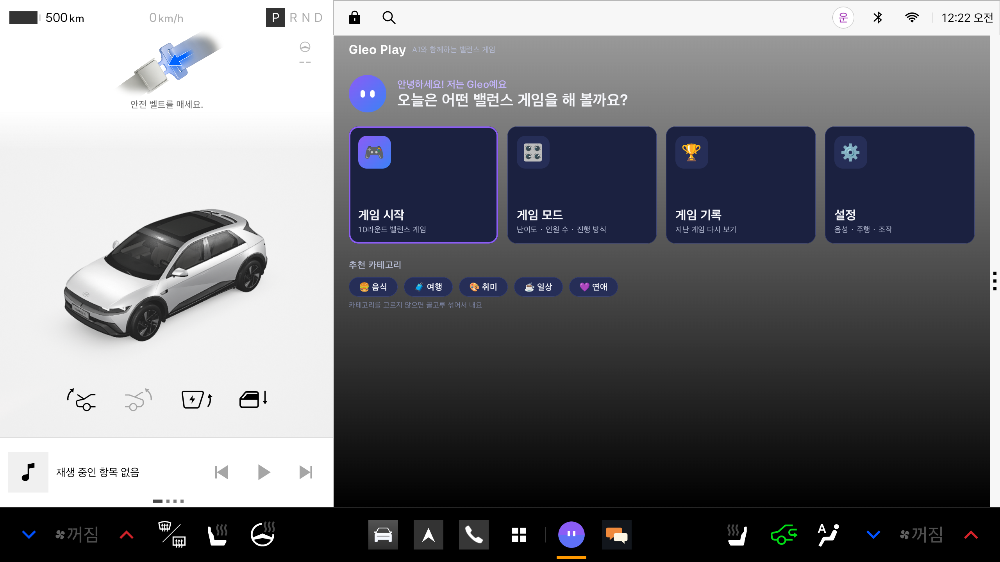
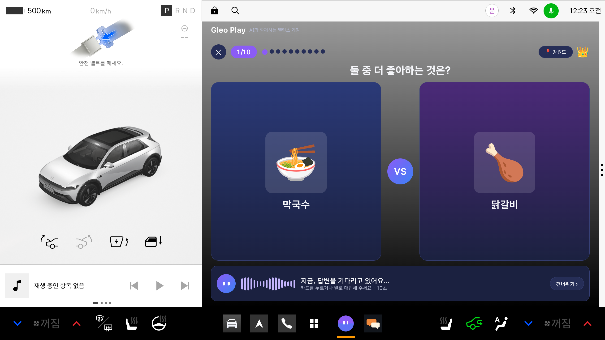
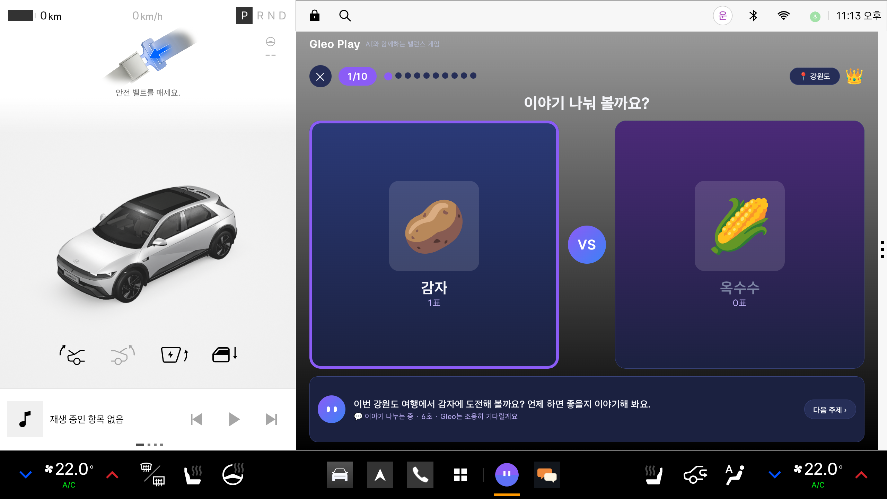
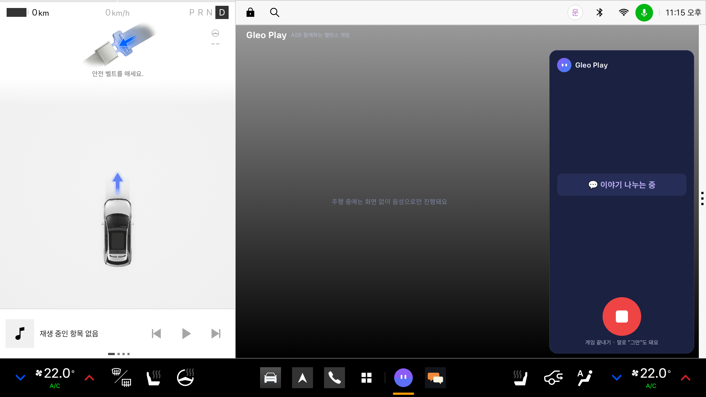
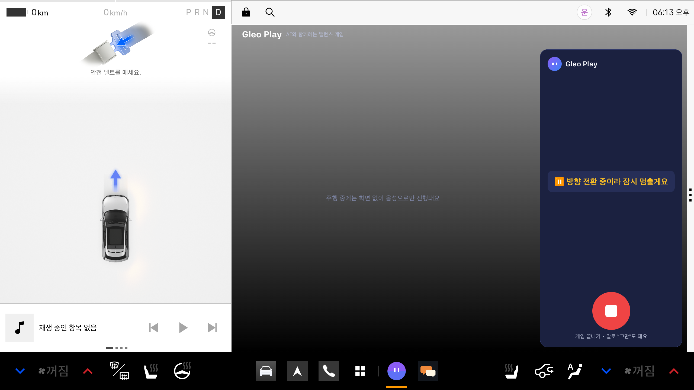
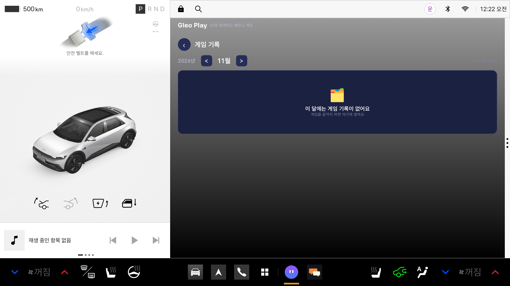

# Gleo Play

차 안에서 Gleo가 밸런스 게임 주제를 던지면, 가족이 하나를 고르고 **왜 골랐는지 이야기를 나누는** Pleos Connect 앱입니다.

- 현대자동차그룹 차량용 앱 개발 공모전 출품작 (패밀리 & 동승자 케어)
- 플랫폼: Pleos Connect (Android Automotive OS, API 34)
- 이 저장소: 앱 소스 코드와 시연용 APK

## 주요 기능

| 기능 | 설명 |
|---|---|
| 고르고, 이야기 나누기 | 질문 → 대답 → 결과와 이어지는 질문 → 가족 대화. 대화가 이어지는 동안 Gleo는 끼어들지 않고, 조용해지면 다음 주제로 넘어갑니다. |
| 말로 대답 | 선택지 이름이나 핵심 단어("김치찌개" → "김치"), "첫 번째/두 번째", "둘 다", "다음", "그만"을 알아듣습니다. 정차 중에는 카드를 눌러도 됩니다. |
| 주행 연동 안전 모드 | 주행 중에는 화면에 상태 한 줄과 정지 버튼만 남기고 음성으로 진행합니다. 방향지시등·급제동·내비 안내·졸음 주의 경고등에서는 스스로 멈추고, 신호가 끝나면 이어 갑니다. |
| 연령별 질문 | 함께 탄 아이(미취학·초등·10대)에 맞는 전용 질문을 먼저 내고 '연애' 카테고리를 잠급니다. |
| 지역 특별 주제 | 강원·제주·부산·전라·충청에서는 그 지역의 음식·명소가 주제가 됩니다. |
| 오늘의 하이라이트 | 게임이 끝나면 가장 오래 이야기한 주제, 의견이 갈린 주제를 정리해 기록에 남깁니다. 대화 내용은 저장하지 않습니다. |

질문 270개는 앱에 들어 있고, 음성 인식·합성은 차량 안에서 처리합니다. 네트워크와 서버가 필요 없습니다.

## 화면

| 메인 | 질문 |
|---|---|
|  |  |

| 이야기 나누기 | 주행 중 |
|---|---|
|  |  |

| 방향지시등 멈춤 | 게임 기록 |
|---|---|
|  |  |

## 실행 방법

Pleos Connect 에뮬레이터(v2.1.0)가 필요합니다.

1. `apk/GleoPlay_demo.apk`를 에뮬레이터 화면에 끌어다 놓아 설치합니다.

   ```bash
   adb install -r apk/GleoPlay_demo.apk
   ```

2. 에뮬레이터 하단 바의 앱 목록에서 **Gleo Play**를 엽니다.
3. **게임 시작**을 누릅니다. 설정 없이 바로 시작됩니다.

마이크로 말해 보려면 에뮬레이터가 켜진 뒤 PC 마이크를 연결합니다.

```bash
adb emu avd hostmicon
```

마이크가 없어도 정차(P) 중에는 터치만으로 끝까지 진행할 수 있습니다.

### 시연 도구

앱 왼쪽 위 **Gleo Play** 글자를 길게 누르면 시연 도구가 열립니다. 위치(지역), 기어(P/D), 가족의 대답, 급제동·내비 안내·졸음 주의 신호를 버튼으로 넣어 볼 수 있습니다. 시연용 APK에만 들어 있습니다.

## 빌드

| 항목 | 버전 |
|---|---|
| JDK | 17 또는 21 |
| Android SDK | API 34 |
| Gradle / AGP / Kotlin | 8.7 / 8.5.2 / 1.9.25 |

```bash
./gradlew testDebugUnitTest
```

```bash
./gradlew assembleDemo
```

Windows에서는 `gradlew.bat`을 쓰고, 한글·공백이 없는 경로에 둡니다. Pleos Connect SDK는 `settings.gradle.kts`에 적힌 공개 저장소에서 받습니다.

## 구성

```
app/src/main/java/com/gleoplay/app
├── core/    게임 엔진, 대답 해석, 이어지는 질문, 질문 고르기, 안전 게이트
├── car/     차량 신호 수집 (Vehicle SDK, NaviHelper, AAOS Car API)
├── voice/   음성 입출력 (Pleos TextToSpeech / SpeechToText, 기기 내 처리)
├── data/    질문 불러오기, 설정·기록 저장
└── ui/      화면 (Jetpack Compose)
app/src/main/assets/questions.json   질문 270개
app/src/test                         자동 테스트 84개
```

## 사용한 Pleos SDK

| SDK | 용도 |
|---|---|
| TextToSpeech 3.3.1 | Gleo 진행 음성 |
| SpeechToText 3.3.1 | 대답·명령 인식, 대화 중 말소리 감지 |
| Vehicle 2.3.2 | 기어, 방향지시등, 브레이크, 졸음 주의 경고등, 연속 주행 시간 |
| NaviHelper 3.0.5 | 회전 안내 지점이 가까우면 대기 |
